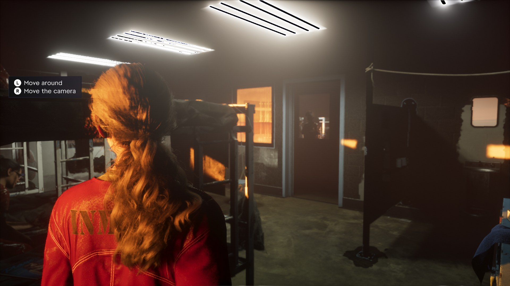
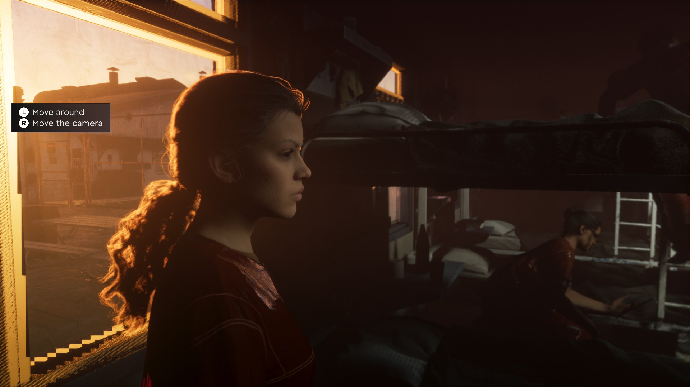
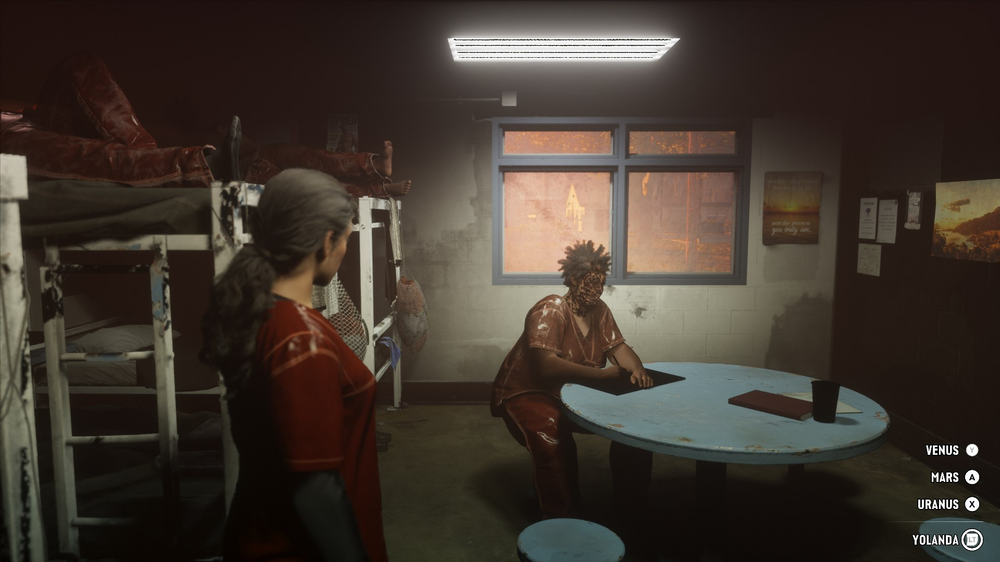

# VIctory | Prologue rendering

This experimental branch of VIctory runs the GTA VI prologue on Windows using Direct3D 12. In the run shown below, the player could move around the cell, approach Yolanda and choose a dialogue response. The rendering work focuses on getting textures to appear when a shader first needs them.



## What works today

The captures come from one Windows 11 run on an RTX 5080. Skin, hair, clothing and parts of the cell rendered together. The eyes and cell door still showed visual defects. The ten samples before the conversation had a median of **2.3 FPS**. Rendering across the rest of the game remains unverified.

| Character in window light | Dialogue with Yolanda |
| --- | --- |
| [](docs/screenshots/prologue/window-light.jpg) | [](docs/screenshots/prologue/dialogue.jpg) |

## Build on Windows

Use your own game files. To build the diagnostic executable used for rendering experiments, run the following from the repository root.

```powershell
cargo build --profile diag -p victory --features diagnostics
```

The executable is written to `target\diag\victory.exe`. The captured run used a warm shader cache and experimental settings. See the [setup instructions and fork history](README-upstream.md) for configuration, launch commands and hardware notes.

Based on [VIctory](https://github.com/Marvisak/VIctory) and [fxceless's rendering fork](https://github.com/fxceless/victory-fork). [GPL-3.0-or-later](LICENSE).
