# Leonida Launcher

`Leonida.exe` is a window for everything `Build.bat` does. It builds the PC port from your own copy of the game,
shows what the build is doing while it runs, and starts the port once it is built. `Build.bat` stays as it is. Both
run the same `make_game.py` with the same arguments, so a build started in either one continues in the other.

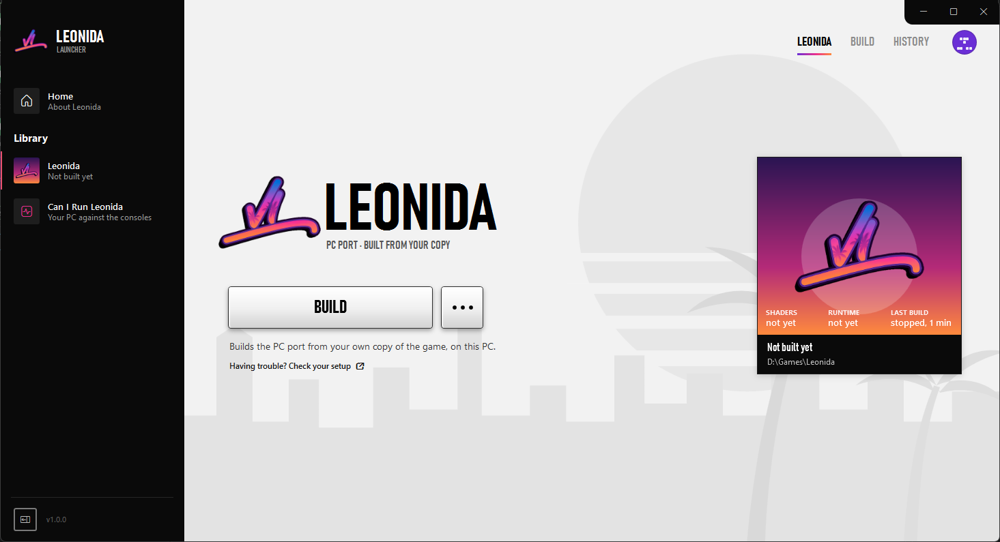

## Get it

**Double-click `launcher_builder.bat`** in the Leonida folder (next to `Build.bat`). It checks for the .NET 8 SDK,
which the build already needs for `rpf9dump`, says where to get it if it is missing, and builds the launcher.

Or run the same thing from a terminal in the Leonida folder:

```powershell
powershell -ExecutionPolicy Bypass -File launcher-wpf\build.ps1
```

This puts `Leonida.exe` next to `Build.bat`. The exe is not committed (`.gitignore`).

- `-Test` runs the core tests first.
- `-SelfContained` makes a larger exe that runs without the .NET Desktop Runtime.

`Leonida.exe` finds the Leonida folder it sits in, or one above it. If it runs from anywhere else, choose the folder
in Settings › Leonida settings.

## What is in it

The sidebar has **Home** and the **Library**, which holds **Leonida** and **Can I Run Leonida**. Each has its own
tabs at the top right. The avatar next to the tabs opens **Settings**.

| Where | What it does |
|---|---|
| **Home** | `README.md` from your checkout, laid out as a landing page, so it is never older than the code it describes. It shows the supported game version and your checkout's commit. Tabs: HOME, PROJECT STATUS, PLATFORMS, HOW IT WORKS and CREDITS. CREDITS lists everyone with commits, with their GitHub profile picture and commit count. |
| **Leonida › LEONIDA** | One button. It shows **PLAY** when the port is built and can start, and **BUILD** otherwise. While a build runs it shows the build's progress. The **⋯** menu has build options, updating the build, checking the game files, the imports dry run, and the folders. |
| **Leonida › BUILD** | The running or last build: each stage, the measured numbers, the shader translation, and the console. |
| **Leonida › HISTORY** | Every build the launcher ran, with its result, duration, stages, shaders, warnings, errors and peak memory. Each build has its log and a "build again with these options" button. |
| **Can I Run Leonida** | Your CPU, GPU and memory, read from Windows, compared with every console on the [community checker](https://assttro.github.io/can-i-run-leonida/)'s list. It runs automatically, and **Detect again** reads the hardware again. |
| **Settings** (avatar menu) | One page per group, one setting per row. **Launcher settings**: *General* (language, theme, start page, sidebar, avatar), *Builds* (how builds stop, end-of-build notice, console text size, log clean-up), *Online*, *About and files* (version, settings file, logs, restore defaults). **Leonida settings**: *Your setup* (`make_game.py`'s own preflight), *Play* (Play's options), *Folders and Python* (the Leonida folder, Python, environment variables). |

The launcher is in **English** and **Polish**; choose the language in Launcher settings. The README pages and the
build's own output stay in English.

There is a **light** and a **dark** theme, or **Same as Windows** (the default), which follows Windows' app mode
(Settings › Personalisation › Colours). The black sidebar, the console and the white BUILD/PLAY button look the same in both.

### The build popup

**BUILD** opens a popup with the three things most builds need:

- your game copy;
- where the port goes;
- what to build: *Ready to run* (about 30 GB), *Everything* (about 330 GB), *Check my game files*, or your own
  stages.

**Advanced options** holds every other `make_game.py` option:

| `make_game.py` | In the launcher |
|---|---|
| `--game` | Your game copy: Browse, or **Find on this PC**, which runs the same search as `--find`. |
| `--pick`, `--find` | The folder dialog and **Find on this PC**. The launcher always passes `--game`, so the build never waits for typing. |
| `--out` | Where the port goes (it remembers recent folders). |
| `--work` | Advanced: work folder. |
| `--stages` | What to build, or **Choose stages**. |
| `--check`, `--full-check` | *Check my game files*; the SHA-256 check is under Advanced. |
| `--wav` | Advanced. |
| `--jobs` | Advanced: parallel jobs. The default is half the CPU threads, as `make_game.py` chooses. |
| `--runtime-build` | Advanced: existing runtime build. |
| `--wave64-emulate` | Advanced: wave64 emulation (auto, on or off). |
| `--no-float-controls`, `--bary-fallback`, `--texel-offset-fallback`, `--f16-interp-fallback`, `--mesh-compute`, `--pc-tail-ubo` | Advanced: fallbacks. |
| Any newer option | Advanced: extra arguments, passed through unchanged. |

Advanced also shows the exact command, copies it, and saves and loads presets. The tests in `launcher-wpf/tests`
check that every `add_argument` in `make_game.py` has a control here, so a new option can't be missed silently.

### What the numbers are

Everything shown is measured. Anything that can't be measured shows "—".

- **Stages and steps** come from `make_game.py`'s own log lines (`shaders: translating…`, `runtime: building`).
- **Shader counts** come from the tools themselves. With `LEONIDA_PROGRESS_DIR` set, `tools/rdna2spirv.py` and
  `tools/shader_disasm.py` write their counts to a small JSON file twice a second (`tools/progress_report.py`). That
  covers the total, compiled, failed, compiling now, remaining, speed, time per shader and the step's ETA. Without
  that variable these tools do nothing new, so `Build.bat` runs exactly as before. The summaries each translator
  process prints at the end are read too.
- **CPU and memory** are those of every process the build runs (Python, translator processes, llvm-mc, compilers).
  They come from the Windows job object that holds them. **PC RAM used** is the whole system's.
- **Output size** comes from walking the port and work folders once a minute.
- **Warnings and errors** count the lines the build printed that say so.
- There is no overall percentage or ETA for the whole build. How long a stage takes depends on the PC, on what an
  earlier build left, and on the game files, so any such number would be invented. The shader step has its own
  measured ETA.

### Stop and Cancel

**STOP** sends Ctrl+C, exactly as in a terminal. `make_game.py` stops its translator processes, and every stage
continues where it stopped the next time you build. If the build hasn't ended after 30 seconds (a setting), it is
ended.

**CANCEL** ends the build and every process it started, at once. The build runs in a Windows job object, so neither
closing the launcher nor a launcher crash leaves translator or compiler processes running.

### Can I Run Leonida

- **CPU:** the name comes from the registry.
- **GPUs:** the names and real video memory come from the display adapter keys.
- **Memory:** size, type (DDR4/DDR5) and speed come from the firmware's SMBIOS table.

The comparison is the community checker's. Its code has no license, so none of it is copied:

1. The launcher opens the live page in a hidden WebView2 window.
2. It types your specs into the page's form, as you would.
3. It picks each console in turn and shows the verdict the page gives.

Your specs are typed into the page on this PC; nothing is sent anywhere. With online features off, only your
hardware is shown.

### Where it keeps things

| What | Where |
|---|---|
| Settings, presets, history | `%APPDATA%\Leonida\Launcher` |
| Build logs (one per run, every line), deleted after 30 days by default | `%LOCALAPPDATA%\Leonida\Launcher\logs` |
| Live shader counts while a build runs (removed after it) | `%LOCALAPPDATA%\Leonida\Launcher\progress` |
| The checker page's browser data; GitHub's contributor list (cached for a day) | `%LOCALAPPDATA%\Leonida\Launcher` |

Nothing is written into the Leonida folder except `Leonida.exe` itself, by `build.ps1`. Nothing goes into the
build's folders that `make_game.py` wouldn't write.

## Screenshots

| | |
|---|---|
| 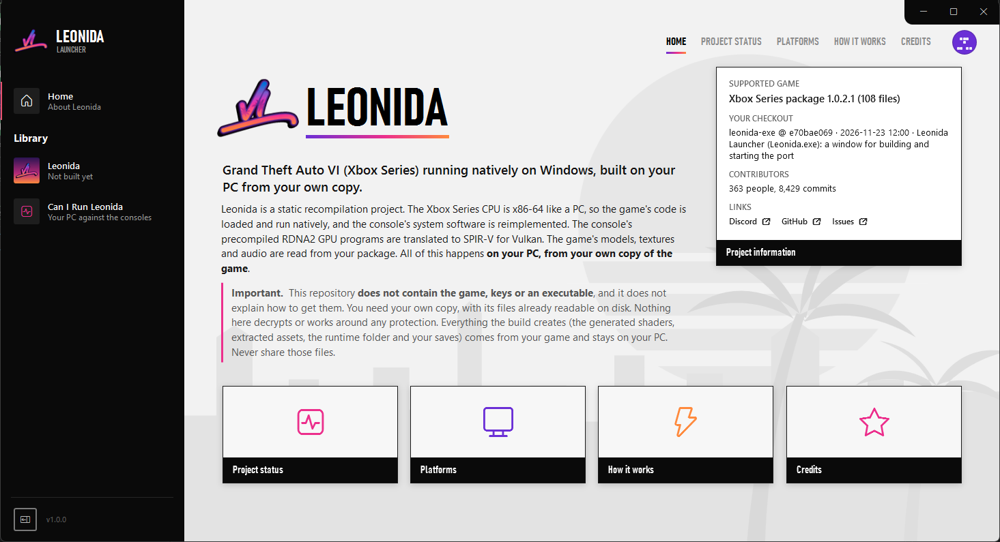 | 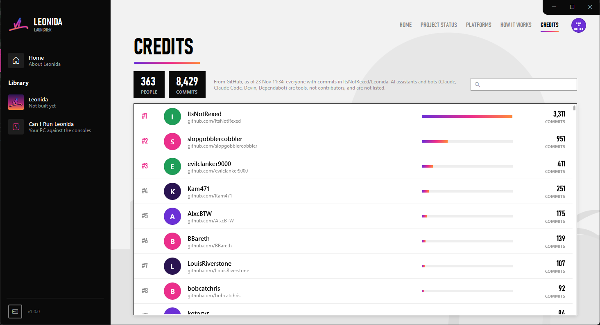 |
| 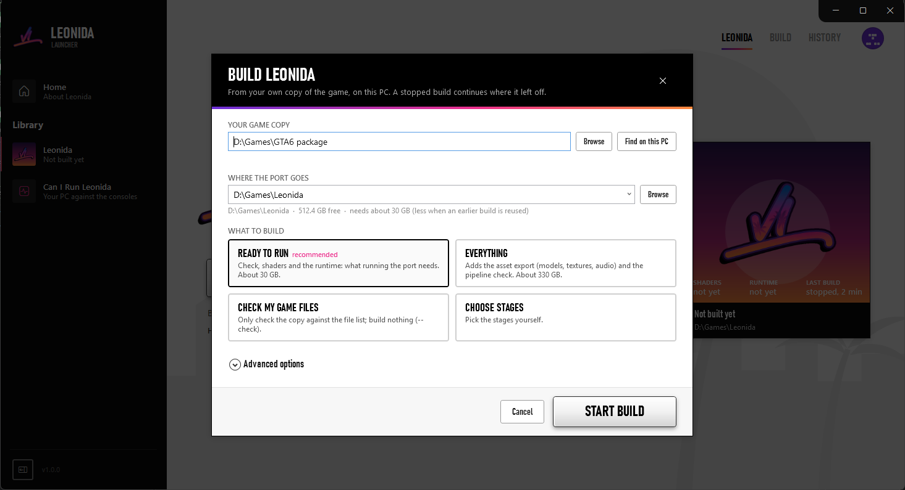 | 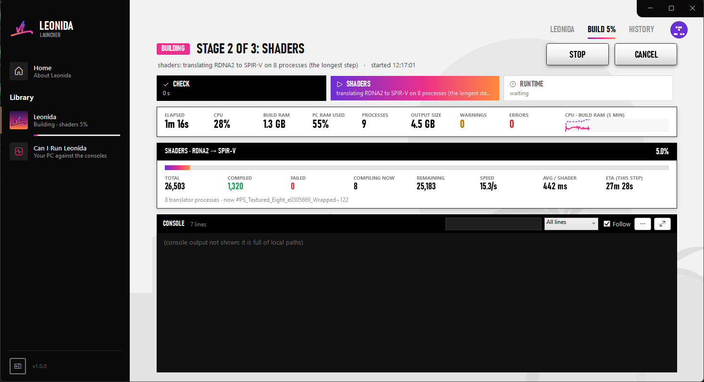 |
| 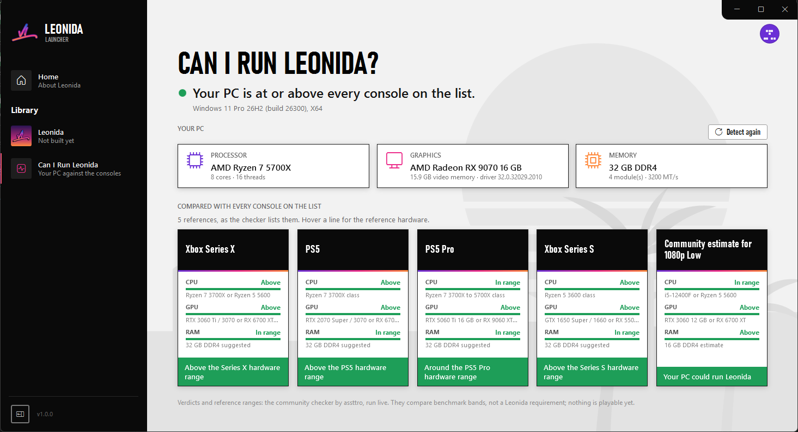 | 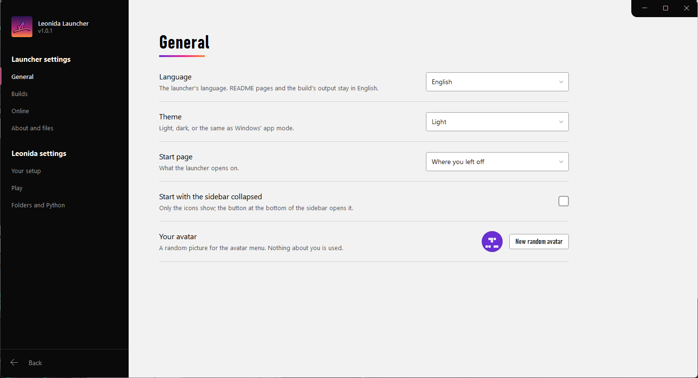 |

Dark theme:

| | |
|---|---|
|  | 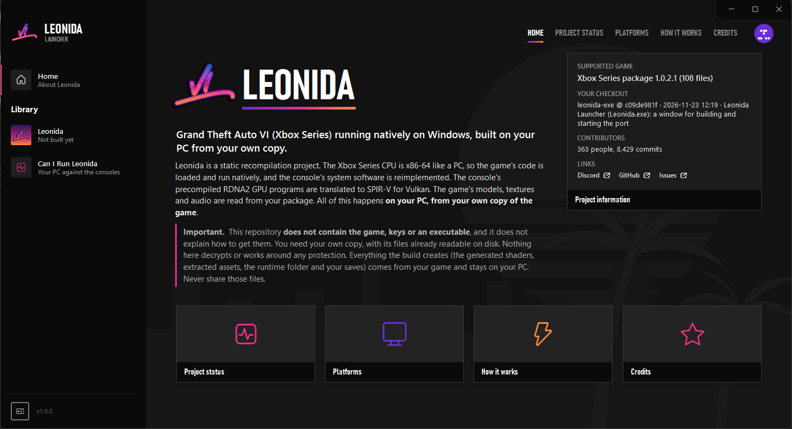 |
| 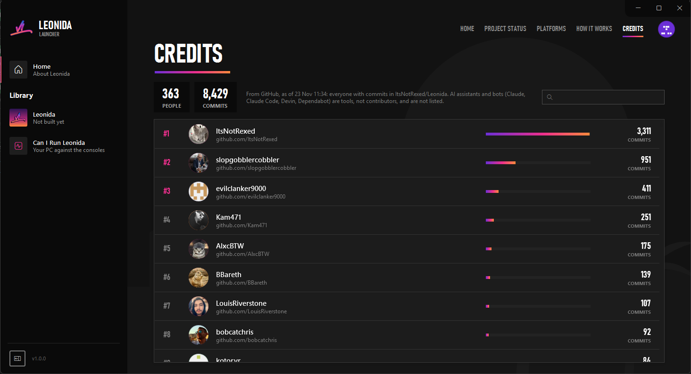 | 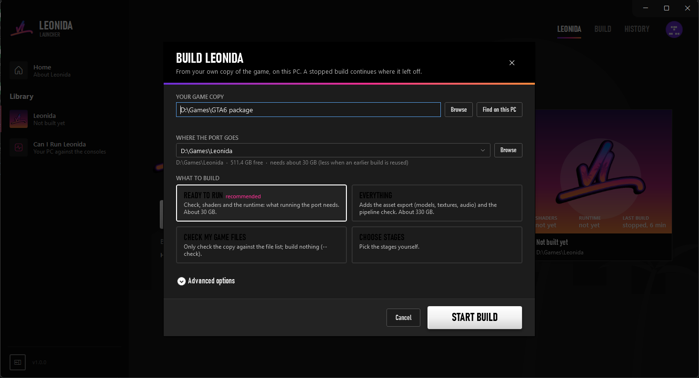 |
| 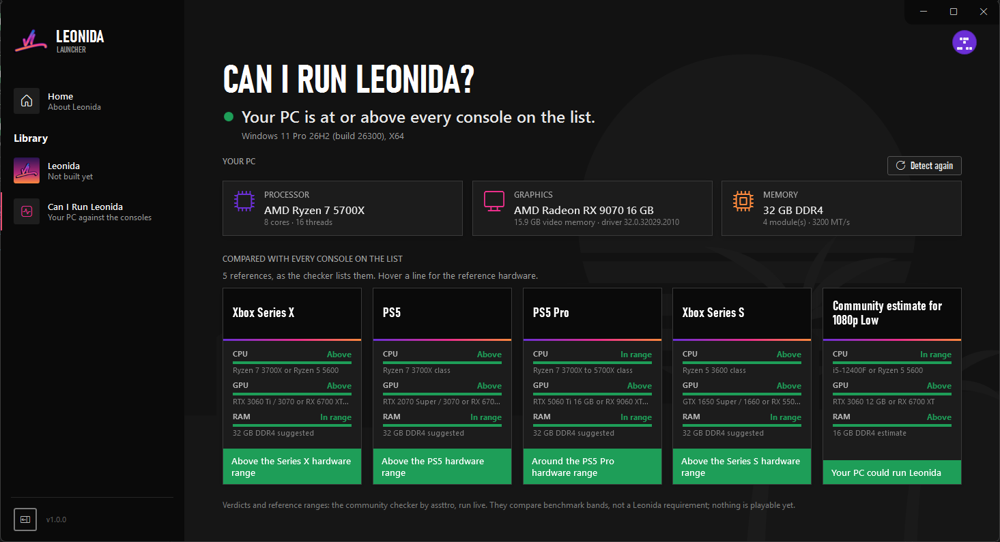 | 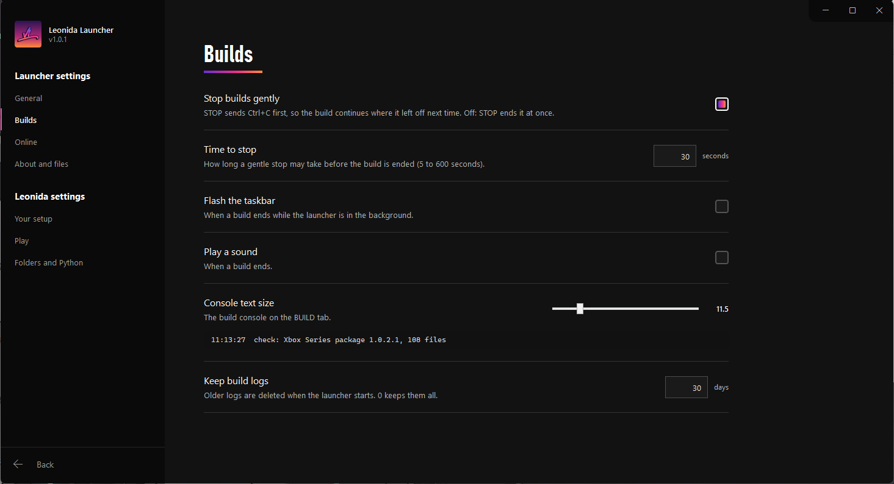 |

## Layout

```
launcher-wpf/
  build.ps1                      publishes Leonida.exe next to Build.bat
  make_icon.ps1                  makes the .ico from assets/logo.png
  src/Leonida.Core/              no UI: options, the build process and its monitoring, settings, history, hardware
  src/Leonida.Launcher/          the WPF app (Leonida.exe)
  tests/Leonida.Core.Tests/      console tests: dotnet run -c Release
tools/launcher_probe.py          make_game.py's defaults and checks as JSON, for the launcher
tools/progress_report.py         the opt-in live counts the shader tools write
```

It is WPF on .NET 8, with one package (Microsoft.Web.WebView2, for the checker page). It lives in `launcher-wpf/`
so it never touches #4578's `launcher/`.
